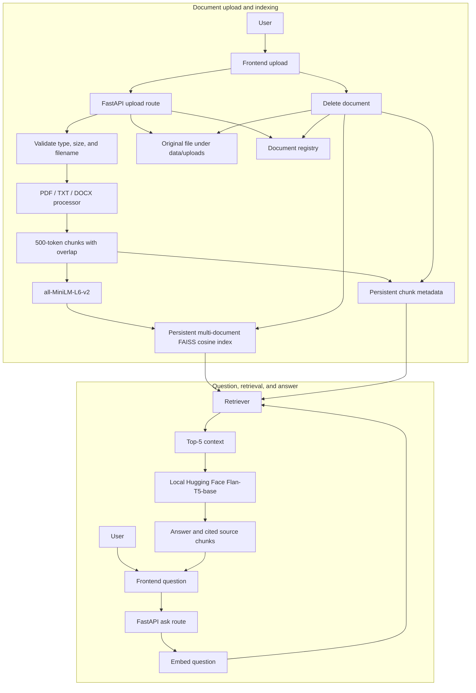

# Multi-Document RAG QA System

A modular document question-answering application built with FastAPI, Sentence Transformers, CPU FAISS, and a local Hugging Face text2text-generation model. Upload PDF, TXT, and DOCX files, ask questions across the indexed library, and inspect the retrieved source passages behind each answer. It does not require an OpenAI API key or call a hosted generation API.

## Project Overview

The service extracts page-aware text from uploaded files, creates overlapping token-aware chunks, embeds those chunks with `sentence-transformers/all-MiniLM-L6-v2`, and stores normalized vectors in a persistent FAISS inner-product index. Query-time retrieval uses cosine similarity and supplies the top five passages as the only document evidence to a local `google/flan-t5-base` text2text-generation pipeline. Source citations are returned separately with the answer.

The vector index, chunk metadata, and document registry are persisted separately under `vectorstore/`. Uploaded files are stored under `data/uploads/`. The frontend is served by FastAPI at the root URL.

## Problem Statement

Finding precise facts across multiple PDFs and office documents is slow, while unconstrained language models can invent details. This project retrieves relevant passages from the user's own files before generating a concise answer, then exposes the source filename, page, chunk, and score so the answer can be checked.

## Features

- PDF, UTF-8 TXT, and DOCX uploads, limited to 10 MB
- PDF page attribution and DOCX core properties carried with chunks
- 500-token chunks with 50-token overlap by default
- Normalized embeddings and persistent cosine-similarity FAISS search
- Incremental indexing and deletion of a document's chunks, metadata, and original upload
- Local Hugging Face generation grounded only in retrieved context, with citations and relevance scores
- Drag-and-drop frontend, document management, chat, and source panel
- API and service tests, including a real local-generation request and actual sentence-transformer inference
- Evaluation notebook for live retrieval, generated answers, reviewer grades, and a results table

## Architecture



## Tech Stack

- Python 3.11+
- FastAPI and Uvicorn
- Sentence Transformers with `all-MiniLM-L6-v2`
- FAISS CPU and NumPy
- pypdf and python-docx
- Hugging Face Transformers text2text-generation pipeline (`google/flan-t5-base`)
- Pydantic, pytest, HTTPX, and Jupyter Notebook
- HTML, CSS, and JavaScript frontend

## RAG Pipeline

1. **Ingestion:** Validate extension, MIME type, size, and basic file structure; save with a generated ID.
2. **Extraction:** Extract PDF text page by page, UTF-8 text, or DOCX paragraphs/tables and core properties.
3. **Chunking:** Split each page independently into token-bounded chunks with source metadata and overlap.
4. **Embedding:** Encode chunks and questions with the configured sentence-transformer; normalize vectors.
5. **Retrieval:** Search a FAISS inner-product index, equivalent to cosine similarity for normalized vectors; filter weak matches.
6. **Generation:** Send only retrieved passages to the LLM with instructions to abstain when evidence is missing.
7. **Citation:** Return document name, page, relevance score, and chunk ID for each retrieved source.

### Chunking Strategy

`tiktoken` splits each extracted PDF page independently into approximately 500-token chunks with a 50-token overlap. It checks decoded text against the tokenizer so BPE boundary changes do not exceed the configured chunk size. TXT and DOCX are treated as page 1 because they do not have intrinsic page numbering.

### Embedding and Similarity

`sentence-transformers/all-MiniLM-L6-v2` produces 384-dimensional vectors. Both document and question embeddings are L2-normalized. FAISS `IndexFlatIP` then computes inner products, which equal cosine similarity for normalized vectors. Chunk metadata is stored separately by FAISS vector ID.

### Generation and Citations

The local Hugging Face `text2text-generation` pipeline uses `google/flan-t5-base` on CPU by default. Its prompt contains only the retrieved chunk text plus the question and grounding/abstention instructions. The API returns answer citations separately with filename, page, chunk index, relevance score, and the retrieved text. No OpenAI SDK or key is used.

## Project Structure

```text
app/
  api/                 FastAPI document and question routes
  models/              Request and response schemas
  services/            Extraction, chunking, embeddings, index, retrieval, generation
  utils/               Upload validation and filename sanitization
  config.py            Environment-backed settings
  main.py              App factory and application entry point
data/
  sample_documents/    Evaluation sample document
  uploads/             User-uploaded files (ignored by Git)
evaluation/
  questions.json       Ten sample evaluation questions
  rag_evaluation.ipynb Live local RAG evaluation and summary table
tests/                 API and service tests
frontend/              Static browser application
vectorstore/           Generated FAISS index and JSON metadata (ignored by Git)
```

## Installation

Python 3.11 or newer is required. From PowerShell in the project root:

```powershell
py -3.11 -m venv .venv
.\.venv\Scripts\Activate.ps1
python -m pip install --upgrade pip
pip install -r requirements.txt
```

On macOS/Linux, use `python3.11 -m venv .venv` and `source .venv/bin/activate` instead.

The first embedding request downloads `all-MiniLM-L6-v2`; the first answer request downloads `google/flan-t5-base` (about 990 MB of model weights). Both models then run locally and are cached by Hugging Face. Keep the model cache outside source control. The default generation device is CPU (`GENERATION_DEVICE=-1`).

## Environment Setup

Create the local environment file:

```powershell
Copy-Item .env.example .env
```

No API key is required. The local generation model is selected with `GENERATION_MODEL` and defaults to `google/flan-t5-base`. `GENERATION_DEVICE=-1` selects CPU; set a nonnegative device index only when a supported GPU is available. Do not commit `.env`; it is ignored by Git.

Optional settings include `GENERATION_MAX_NEW_TOKENS`, `CHUNK_SIZE_TOKENS`, `CHUNK_OVERLAP_TOKENS`, `RETRIEVAL_TOP_K`, and `MIN_RELEVANCE_SCORE`. Defaults are declared in `app/config.py`.

## Running the Backend

From the project root with the virtual environment active:

```powershell
uvicorn app.main:app --reload
```

The API and frontend are available at <http://127.0.0.1:8000>. Interactive API documentation is at <http://127.0.0.1:8000/docs>.

## Running the Frontend

The frontend is served by FastAPI; no separate build step or frontend server is needed. Open <http://127.0.0.1:8000> after starting the backend. If serving static files separately, configure the frontend origin in `CORS_ORIGINS` and serve `frontend/` over HTTP rather than opening `index.html` directly.

## API Endpoints

| Method | Path | Description |
| --- | --- | --- |
| `GET` | `/api/health` | Health status |
| `POST` | `/api/documents/upload` | Upload and index a PDF, TXT, or DOCX file (`multipart/form-data`, field `file`) |
| `GET` | `/api/documents` | List indexed documents |
| `DELETE` | `/api/documents/{id}` | Delete the uploaded file and all indexed chunks |
| `POST` | `/api/ask` | Retrieve relevant chunks and generate a cited answer |

Upload and listing responses include both `id` and `document_id`, filename, byte size, status, page/chunk counts, and upload timestamp. Ask responses contain the answer and source chunks with filename, page number, chunk index, text, cosine score, relevance score, and chunk ID. The older `document`, `page`, and `relevance_score` names remain for compatibility.

## Example API Requests

Health check:

```powershell
Invoke-RestMethod http://127.0.0.1:8000/api/health
```

Upload a document:

```powershell
curl.exe -X POST http://127.0.0.1:8000/api/documents/upload -F "file=@data/sample_documents/rag_fundamentals.txt"
```

Ask a question:

```powershell
$body = @{ question = "What are the stages of a typical RAG pipeline?" } | ConvertTo-Json
Invoke-RestMethod -Uri http://127.0.0.1:8000/api/ask -Method Post -ContentType "application/json" -Body $body
```

List documents:

```powershell
Invoke-RestMethod http://127.0.0.1:8000/api/documents
```

## Evaluation

Run the tests with `python -m pytest -q`. Tests exercise real PDF/TXT/DOCX uploads, the 10 MB limit, extraction page mapping, overlap, the configured Sentence Transformer, normalized embeddings, FAISS top-five search/persistence/deletion, document listing, health, citations, and local Hugging Face generation. The API integration tests use the actual local models; no fake answers are used.

Open `evaluation/rag_evaluation.ipynb` in Jupyter and run its cells with the backend running. It indexes the sample document if needed, asks the live API all ten questions, records actual generated answers and top-five sources, and prompts a reviewer to classify each answer as `Correct`, `Partially Correct`, or `Incorrect`.

It calculates:

- `retrieval_accuracy` / Recall@5 (%) = 100 × questions with the expected source and page in top five ÷ all questions
- `answer_accuracy` (%) = 100 × correct ÷ all questions

The notebook computes new results from live API answers and reviewer labels; it does not preload grades or claim the measured run below as a guarantee for future runs. Retrieval relevance is measured by whether the expected source/page appears in the returned top five.

## Evaluation Results

Measured run using `google/flan-t5-base` on CPU against the sample document in a temporary isolated FAISS store:

- Correct: 9/10
- Partially correct: 1/10
- Incorrect: 0/10
- Exact-correct answer accuracy: 90%
- Expected source/page retrieved in top five: 10/10 (100%)

Answers were generated by the actual embedding, FAISS, and local HF pipeline. The grading is a reviewer judgment of those captured outputs; rerunning with a different model/version or prompt may change it. The evaluation notebook recomputes results from its own live run and requests reviewer grades; these figures are not guaranteed for future runs.

## Limitations

- The local Flan-T5-base model uses about 990 MB of weights and is slower on CPU than a hosted model; long or nuanced questions may still be answered incompletely.
- The first run requires network access to download the two Hugging Face models; subsequent generation is local.
- Scanned PDFs need OCR, and PDF text extraction depends on extractable page text.
- TXT and DOCX do not have intrinsic page layout; their chunks use page 1.
- Evaluation labels are reviewer judgments; retrieval relevance does not guarantee answer correctness.
- The local FAISS index is intended for a single application process and does not provide authentication or multi-user isolation.

## Screenshots

No screenshots are included yet. Start the application and capture the library, chat, and source panel at your preferred viewport for project documentation.

## Future Improvements

- Add authentication, per-user document isolation, and configurable retention
- Add OCR for scanned PDFs and richer table/layout extraction
- Add reranking and configurable embedding backends
- Add rate limits, observability, and background ingestion jobs
- Compare compact local instruction models and improve calibrated evaluation
- Add document replacement, filters, and source passage previews
